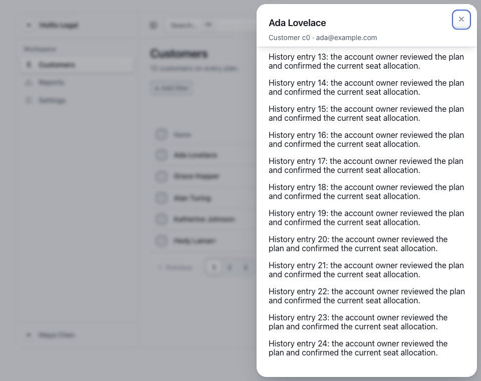
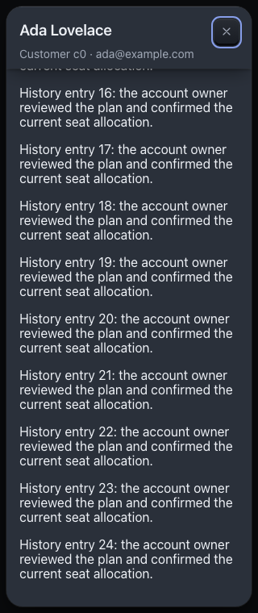

# Detail-surface engineering validation

Issue [#616](https://github.com/richlaconte/altitude/issues/616); base `4378c0c8533ec771ccc3322fa1d7aca6c339c951`; package `0.31.21`; reviewed 2026-11-07. These are engineering observations on the existing AppSkeleton, not participant evidence.

## Observed task and boundary cases

The task is to open a named customer, change Seats, close the Sheet and resume the same queue. The modal choice deliberately suspends the queue. The record repeats its name and stable identifier; changing Seats to 41 updates the same source row. Opening the Sheet preserves the table's layout dimensions: an overlay, not reserved space or inline expansion.

The browser matrix runs both Daylight and Nightfall at 960px and 320px, with normal and reduced motion. It checks keyboard entry, modal semantics, visible name/identifier, an accepted property change, vertical scrolling through injected long history, no horizontal overflow inside the panel, reachable unobscured Close, focus return and zero page errors. At 320px the table keeps its own horizontal scrolling while the Sheet fits the viewport. This is a reflow proxy, not a real browser zoom or native screen-reader test.

Two adversarial DOM probes separate source identity from a particular DOM node. Removing the invoker while detail is open returns focus to the named Customers heading after modal isolation releases. Replacing the invoker with an equivalent control bearing the same customer ID returns focus to that current control. A third probe gives focus to Settings as isolation releases: the fallback preserves that newer meaningful destination. These probes do not claim the fixture has a production deletion/refetch service.

Long history is deliberately injected by the test. The observed result is that the panel can scroll and close while retaining identity, not that a long history or several-record comparison is a good task for this Sheet. That surface-choice boundary remains contextual and unvalidated with people.

## Reproduction and results

Set `CHROME` to a local Chromium binary. Local verification used Google Chrome `157.0.8103.38`, Node `26.5.0`, root React `19.3.0` for package checks and pinned React `18.3.1` for the design-system preview.

| Command (from repository root unless stated) | Observed result |
| --- | --- |
| Baseline `npm run build`; `cd build && node shoot.mjs AppSkeleton daylight,nightfall 960 && node checks/app-skeleton.mjs` | Package built; both renders reported no errors; original 11 assertions passed. |
| New removed-source regression against the old fixture | Failed at the expected missing Customers-heading focus return; 11 old assertions passed. |
| New replacement-source regression before stable-ID recovery | Failed only the replacement-control focus return; 85 other assertions passed. |
| `node scripts/pattern-previews.mjs --check` | Canonical fixture and preview source match. |
| `node build/checks/pattern-types.mjs` | Public-declaration positive/negative contracts and compositions passed. |
| `npm run typecheck` | Component, example-app and site types passed. |
| `cd build && node build.mjs && node previews.mjs` | Bundle/previews regenerated; no component implementation changed. |
| `cd build && DPR=2 node shoot.mjs AppSkeleton daylight,nightfall 960 && node checks/app-skeleton.mjs` | Both renders have no errors; 86 assertions pass, including the eight scheme/width/motion cases. |

The full `npm run check:framework` passed all individual checks through the evaluator suites, but its final measurement initially failed because a concurrent local rebuild had cleared `dist` and stopped on the then-unwritten validation-link target. That was a local sequencing error. Final verification is run only after the completed package build, with no concurrent output mutation; the frozen-build rerun exited 0. It passed all framework checks, including 67 workflow assertions, 22 installed accessibility state/mode scans, packed ESM/CommonJS/types/CLI and installed guidance checks, schema/reference/version/freshness, evaluator regression suites and the final measurement. This does not change the human/AT limitations below.

`build/test/detail-long-daylight-960.png` and `detail-long-nightfall-320.png` show the long-content probe. `build/test/detail-source-narrow.png` shows focus returned to the source at 320px. `shoot.mjs` records both untouched source-view schemes at DPR 2.

## Visual inspection

The captured long-content probes were inspected: the record title and identifier remain readable in the sticky header, body text wraps, the last history paragraph is reachable, and the focused Close control remains visible at both sizes. The Daylight image also shows why this modal presentation is unsuitable for simultaneous queue comparison: the source page is intentionally unavailable.

## What remains unmeasured

No participant evaluation, native assistive-technology session, real browser zoom session, cross-browser sweep or production persistence test was run. Automated semantics and geometry do not establish complete accessibility. The personal preference summaries in the research record remain scoped: the 2/5 long-detail relative winner is not approval or evidence of general effectiveness. Evaluate genuine comparison tasks, dynamic permission loss, dirty drafts, real removal and URL/history behaviour in the application before choosing a surface.
