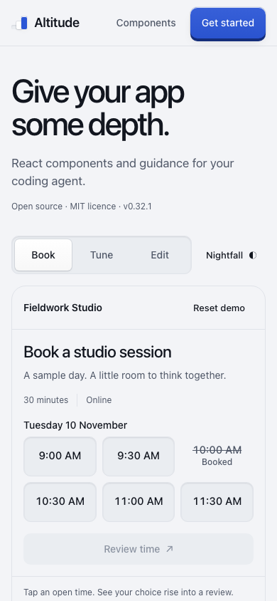
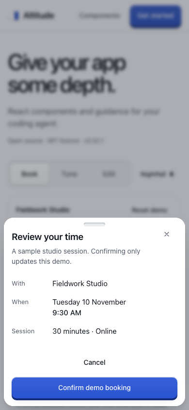

# Mobile showcase validation

7 November 2026 · based on `main` at `4c4a3df` (0.32.1)

## Recorded checks

| Check | Result |
| --- | --- |
| `npm run build-site` | Pass; homepage, agent page, agent-readable guides, and eight example apps build |
| `npm run typecheck` | Pass; components, example apps, and site |
| `node --test site/workbench-state.test.mjs` | 3 tests pass |
| `npm run check:tells-lint` | 168 files, 25 rules, no findings |
| `CHROME='/Applications/Google Chrome.app/Contents/MacOS/Google Chrome' node scripts/record-check.mjs site-showcase node scripts/check-site.mjs` | 175 assertions, 8 scenarios, 0 failures; Chromium 157.0.8103.38 |
| `node scripts/ci-checks.mjs --check` | Check registry is complete |
| `node scripts/check-version-bump.mjs origin/main` | No shipped package changes; no bump required |
| `git diff --check` | Pass |

Before implementation, the site build, type checks, and three board-state tests passed. The initial phone browser assertion failed because the Book tab did not exist, establishing that it detects the intended change.

The focused browser suite now runs in CI immediately after the homepage build, through the existing check recorder. It uses the build kit's Chromium by default and accepts `CHROME` for a local browser. CI retains its log and failed-run screenshots. Local generated evidence lives under ignored `build/test/site/` and `build/test/alt-05/`.

## What the browser suite establishes

1. The phone initially mounts Book and does not mount Board. No time starts selected; the booked time cannot be chosen. A free choice is visible in a 390×844 initial viewport. Actual touch taps open review, cancel without committing, confirm the selected time, and update the receipt when another time is chosen.
2. Booking choices, reminder preferences, and accepted note edits survive tab and theme changes. Preferences change the visible preview, including whether tomorrow's sessions appear.
3. A deliberately refused note save retains its draft. Retry reaches the component's committed read state. Reset during a delayed save prevents that old value from landing or moving focus.
4. Keyboard arrows/Home/End move picker focus without selecting; Space selects. The review sheet contains Tab and Shift+Tab focus, Escape closes it, and focus returns to its surviving opener. Keyboard scene navigation works.
5. At 320, 375, 390, 430, 640, 641, 768, and 1280 CSS px, the document fits. Each mobile scene fits at the compact widths. Operable controls have at least 44×44 touch targets, using labelled hit areas where appropriate.
6. Crossing the breakpoint with a sheet open removes its portal, releases scroll/isolation ownership, and restores focus to the replacement showcase. Focus outside the showcase stays outside. A pending write in the unmounted family cannot affect the replacement.
7. Forced colors retains the selected time's named, outlined state. Reduced-motion interaction and visible sheet dismissal work. Scoped axe checks report no violations in the tested mobile scenes, failed edit, nightfall booking scene, and sheet.
8. Desktop still starts with Plan a project; its move button, accepted note edit, approval and rejection outcomes work. Example-app, install, and agent-demo navigation remains present.

The suite found two composition-level target-size problems before completion: the reused failure-toggle label was only 24px tall, and the small square sheet close action was 40px wide. Mobile-scoped layout rules now give both the intended 44px target. Public component styles and APIs were not changed.

Independent design/spec and code reviews found no remaining actionable issues. The review also tightened preference-row layout and the responsive focus fallback so it does not override a new focus decision inside the replacement demo.

## Visual review and payload

The actual local page was inspected in the in-app browser at 390×844 and 320×740 with the site's fonts, including time selection, the bottom sheet, confirmation, and the compact preference rows. Deterministic browser screenshots below use system fallbacks because external network requests are blocked in the suite. Phone, sheet, nightfall, 320px, forced-color, and desktop screenshots are generated by the check.

| Initial phone task | Review sheet |
| --- | --- |
|  |  |

The build reports approximately **602 KiB → 617 KiB** of minified homepage script: about **15 KiB / 2.5%** more before compression. This includes the site's existing inlined example previews; it is not a network-transfer or Core Web Vitals measurement. The agent-page script remains about 451 KiB. No dependency was added. Both showcase families remain in the portable script; mounting only the active family avoids its runtime work, not its download cost.

## Limits and next measurement

These results establish the tested behavior in browser emulation, not complete accessibility or improved conversion. The complete repository's sharded CI suite runs on the PR; the local pass was scoped to this site change and the repository checks above.

Still to validate on physical devices: iOS Safari and Android Chrome, browser chrome and the onscreen keyboard during note editing, safe-area behavior, VoiceOver/TalkBack, and actual thumb comfort. Human testing should compare discovering a first action, completing the booking, recovering an edit, explaining the result, and reaching installation. No analytics or tracking was added, and no conversion improvement is claimed.
