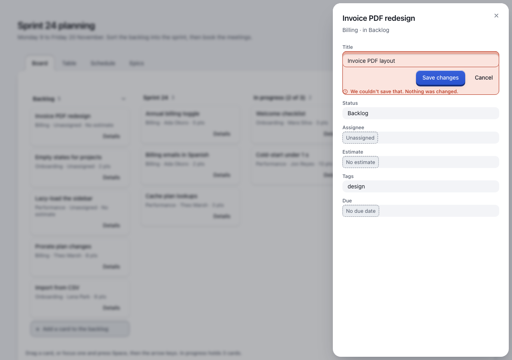
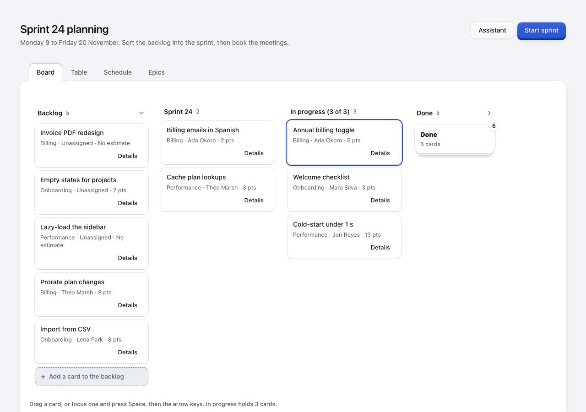

# Engineering smoke pilot — 7 November 2026

Protocol **1.0.0**. **Participant evaluation: unrun.** No participants were recruited and no model/maintainer preferences were collected. This report records browser engineering observations in a simulated service, not human recognition, satisfaction, accessibility conformance or production persistence.

## Frozen implementation and reproduction

Source: `4fd91df21fbe6ec3df66ce7e0ac6407929170140` (clean worktree), package `0.31.20`, React `19.3.0`. Exact browser, OS, motion/input settings, artifact, lockfile and runner digests are in [summary.json](summary.json) and each raw record. The complete planning-board app was unchanged from main `4378c0c`; only the measurement harness/protocol were added. Each case used a fresh browser context and the original seed. There is one implementation, with normal and reduced motion recorded separately; no candidate comparison was performed.

```sh
npm ci && npm ci --prefix build
node --test evals/interaction/*.test.mjs
CHROME='/absolute/path/to/chromium' node evals/interaction/smoke.mjs build/test/interaction-new-run
```

Reproduce from the source commit above in an isolated worktree. The output destination must be new. The runner rebuilds the stimulus and emits its exact HTML, JSON, Markdown and screenshots. The committed records retain the artifact SHA-256; generated HTML is reproducible from that source rather than duplicated into the repository.

## Observations

All **28 engineering checks passed**, seven in each journey/motion context. The service is an in-browser simulation; write logs and localStorage reload confirm its outcomes only.

| Journey / mode | Result | Raw record |
| --- | --- | --- |
| Failed field edit, normal motion | Saving state preceded rejection; draft and original identity remained; explicit Save changes retried once; accepted title survived reload. | [Record](field-edit-normal.json) |
| Failed field edit, reduced motion | Same state and recovery observations, with reduced motion enabled. | [Record](field-edit-reduced.json) |
| Status movement, normal motion | Same `c1` record moved once from Sprint 24 to In progress; focus and identity stayed associated; Title editing reopened the same record. 26 intermediate x/y geometry frames and 37 nonidentity-transform frames were observed among 47 samples. | [Record](record-movement-normal.json) |
| Status movement, reduced motion | Same result and continuation, with 0 intermediate x/y frames and 0 nonidentity-transform frames among 47 samples. | [Record](record-movement-reduced.json) |

Before the first accepted write the fixture has no localStorage snapshot. The rejection check explicitly records null storage, checks the original `c3` card and Sheet name, retains the draft, and observes the rejected request; it does not pretend to read a persisted original value from absent storage. After successful retry the new title is actually read back after reload.

The baseline's retry button is labeled **Save changes**, not Retry. This is recorded accurately rather than silently redesigning the stimulus. Whether people understand that recovery remains a participant question. Live-region text was observed in the DOM; no assertion is made about actual screen-reader speech.

## Visual inspection

Codex inspected the captured failure and movement endpoints: the original record heading remains beside the changed draft and complete failure message; Save changes and Cancel remain visible; the moved card has its name, focus outline and named destination column. This is an agent visual review, not participant evidence or a complete accessibility review. A screenshot cannot prove that animation was seen; the per-frame records separately establish delivered geometry.

| Normal motion | Reduced motion |
| --- | --- |
|  |  |
|  |  |

## Harness development and interpretation limits

Excluded local feasibility runs preceded the frozen pilot. They exposed harness assumptions: clicking a hidden native radio instead of its visible label; looking for a combobox role on the Select trigger; dropping before keyboard focus returned to a reparented card; expecting the baseline recovery label to say Retry; and looking for busy state on the wrapper instead of its pending child. Those were harness failures, not negative preferences. Each run kept its own directory; none produced participant data. A successful pre-review pilot was superseded by stricter provenance and reduced-motion checks. Cross-review then required artifact/source equality, both x/y and transform checks, accurate mixed-input labeling, and explicit absent-storage evidence; regression tests verify those cases.

The 16 deterministic format/health cases cover the required broken demo, 1/5 winner, confused comparison and successful task with low satisfaction, plus malformed/current-exposure provenance, missing judgments, vertical/scale-only motion and unchanged endpoints. They were checked red before implementation and green afterward. The pre-change planning-board suite also passed **45 checks**. Full repository framework/CI results belong in the PR's current validation status, since they execute beyond this frozen pilot.

Unrun: participant comprehension/recognition, absolute ratings and comparative choices; representative recruitment; real assistive technology; touch/pointer-only tasks; forced colors, narrow viewport or zoom in this pilot; different browsers/OS and real-server persistence. Existing app tests provide other engineering coverage but do not fill these participant gaps. Font requests were blocked consistently, so the pilot used system fallback fonts. Timings/frame counts describe this run, not a threshold for human effectiveness.

The protocol is ready for a separately agreed participant plan after reviewing actual candidate stimuli and the intended audience/context. There is no winner or effectiveness claim here.
